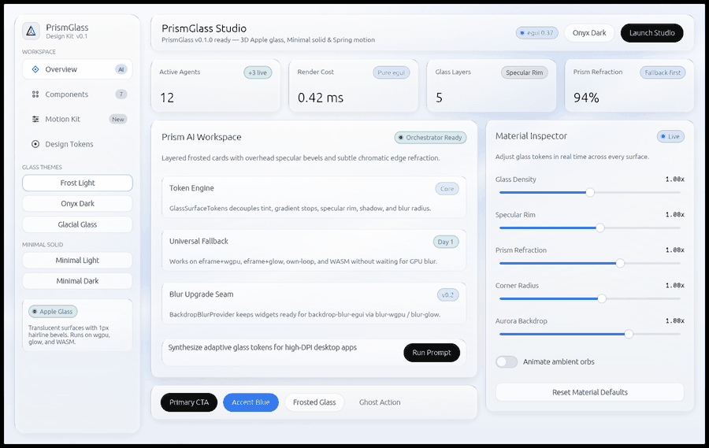
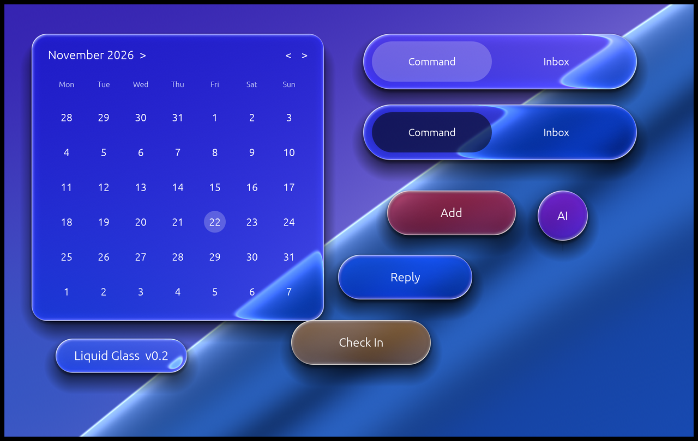
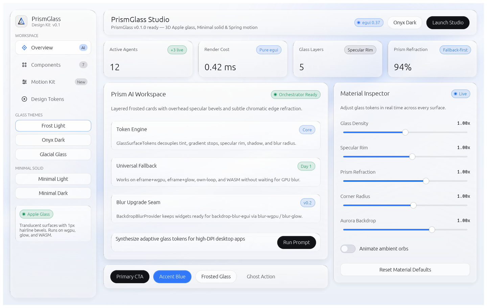
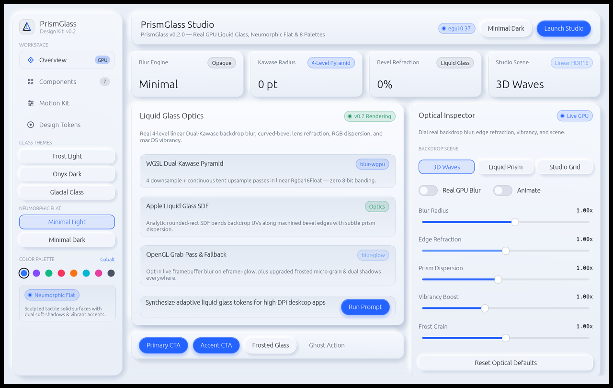
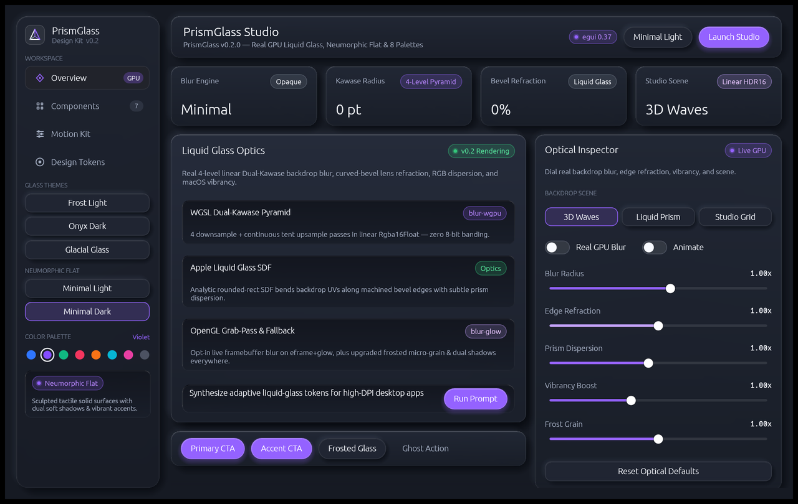

# egui-prismglass

<div align="center">

**A fallback-first 3D glassmorphic & minimal design system for [`egui`](https://github.com/emilk/egui) — now with real GPU backdrop blur & Apple Liquid Glass optics.**

Pure-WGSL 4-level linear Dual-Kawase blur pyramid, curved-bevel lens refraction, subtle RGB chromatic dispersion, macOS vibrancy, frosted micro-grain, and live OpenGL grab-pass blur — with a zero-dependency pure-`egui` fallback that works on **every** backend.

[](https://github.com/kayoinreality/egui-prismglass/actions/workflows/ci.yml)
[](https://crates.io/crates/egui-prismglass)
[](https://docs.rs/egui-prismglass)
[](LICENSE)
[](https://crates.io/crates/egui/0.37.0)



</div>

---

## Real GPU Liquid Glass & Minimal Themes

| **Apple Liquid Glass Optics (Snell Refraction & Tinted Pills)** | **Glacial Glass — Liquid Prism (Real GPU)** |
| :---: | :---: |
|  |  |

| **Frost Light (Real GPU Dual-Kawase)** | **Onyx Dark (Real GPU Dual-Kawase)** |
| :---: | :---: |
|  |  |

| **Minimal Light (Neumorphic Flat)** | **Minimal Dark (Neumorphic Flat + Violet)** |
| :---: | :---: |
|  |  |

<div align="center">

**Tactile Neumorphism (Light & Dark) + 8 Curated Vibrant Color Palettes Across Every Theme**


</div>

---

## Why `egui-prismglass`?

Most desktop teams still reach for Electron because native immediate-mode UIs take too long to style with modern optical polish. **`egui-prismglass` brings Apple-grade Liquid Glass & Minimal design straight to native Rust + `egui` with `#![forbid(unsafe_code)]`:**

1. **Real GPU Dual-Kawase + Apple Liquid Glass (`feature = "blur-wgpu"`)** — Pure-WGSL 4-level linear `Rgba16Float` blur pyramid (zero 8-bit banding), analytic rounded-rect SDF anti-aliasing, curved-bevel optical lens refraction, subtle RGB chromatic dispersion, macOS vibrancy saturation boost, Jimenez IGN frost micro-grain, and directional 3D studio bevels. Works on default `eframe` (`wgpu`), own-loop `egui-wgpu`, and headless `egui_kittest`.
2. **Real Live-Framebuffer OpenGL Grab-Pass (`feature = "blur-glow"`)** — Wraps `backdrop-blur-glow` (`glow 0.17` / `egui_glow 0.37.0`) to grab and blur live OpenGL 3.3 / GLES 3.0 / WebGL 2.0 framebuffers on `eframe+glow`, layered cleanly under our 3D directional bevels.
3. **Zero-Dependency Fallback (`default = []`)** — Every widget still renders cleanly out of the box with pure `egui` meshes, cached procedural frosted micro-grain, dual-layer 3D elevation + contact shadows, and directional bevels on **every** backend.
4. **Two First-Class Design Modes (`SurfaceStyle::Glass` & `SurfaceStyle::Minimal`)** — Switch the entire app between 3D Liquid Glass (`Frost Light`, `Onyx Dark`, `Glacial Glass`) and ultra-clean solid flat UI (`Minimal Light`, `Minimal Dark`) in one line.

---

## Try the Demo in One Command

```bash
# Default: real WGSL Dual-Kawase & Liquid Glass on eframe + wgpu
cargo run -p demo

# OpenGL live-framebuffer grab-pass blur on eframe + glow
cargo run -p demo --example glow_blur --no-default-features --features blur-glow
```

The interactive **PrismGlass Studio** demo includes:
- Live **Optical Inspector** sliders for **Blur Radius**, **Edge Refraction**, **Prism Dispersion**, **Vibrancy Boost**, **Frost Grain**, and **Glass Density**
- Live **Studio Backdrop Scene** switcher (`3D Waves`, `Liquid Prism`, `Studio Grid`) and **Real GPU Blur vs Fallback** toggle
- **Component Gallery**, **Motion & Spring Physics** playground, and **Design Token Explorer**

---

## Quick Start

### 1. Add `egui-prismglass` to `Cargo.toml`

```toml
[dependencies]
egui = "0.37.0"
# Enable `blur-wgpu` for real WGSL Dual-Kawase + Liquid Glass on eframe (default wgpu backend):
egui-prismglass = { version = "0.2.0", features = ["blur-wgpu"] }
# Or use `features = ["blur-glow"]` for eframe+glow, or omit `features` for zero-dep fallback.
```

### 2. Install the GPU Blur Provider Once During Setup (`eframe`)

```rust
// Inside eframe::run_native(..., Box::new(|cc| { ... })):
#[cfg(feature = "blur-wgpu")]
if let Some(render_state) = cc.wgpu_render_state.as_ref() {
    egui_prismglass::blur_wgpu::install(&cc.egui_ctx, render_state);
}
```

*(For `eframe` + `glow`, call `egui_prismglass::blur_glow::install(&cc.egui_ctx, gl)` and call `provider.destroy(gl)` inside `eframe::App::on_exit`.)*

### 3. Compose Liquid Glass Widgets

```rust
use egui_prismglass::{
    BadgeVariant, GlassBadge, GlassButton, GlassCard, GlassElevation,
    PrismContextExt, PrismTheme, paint_prism_backdrop_ui,
};

fn render_ui(ui: &mut egui::Ui) {
    // 1. Pick Glass (frost / onyx / glacial) or Minimal Solid (minimal_light / minimal_dark):
    let theme = PrismTheme::onyx(); // or PrismTheme::frost() / PrismTheme::glacial()
    ui.ctx().set_prism_theme(theme.clone());

    // 2. Paint the studio backdrop (automatically GPU-accelerated when `blur-wgpu` is active):
    let rect = ui.max_rect();
    paint_prism_backdrop_ui(ui, rect, &theme, 0.0, 1.0);

    // 3. Every GlassCard / GlassPanel / GlassSidebar automatically gets real GPU blur & optics:
    GlassCard::new()
        .elevation(GlassElevation::Elevated)
        .show(ui, |ui| {
            ui.horizontal(|ui| {
                ui.heading("PrismGlass v0.2");
                ui.add(GlassBadge::new("Real GPU Blur").variant(BadgeVariant::Success).dot(true));
            });

            ui.label("Dual-Kawase linear blur, curved-bevel refraction, and 3D machined bevels.");
            ui.add_space(8.0);

            ui.horizontal(|ui| {
                if ui.add(GlassButton::primary("Launch").pill(true)).clicked() {
                    // handle primary action
                }
                let _ = ui.add(GlassButton::accent("Accent Blue").pill(true));
                let _ = ui.add(GlassButton::secondary("Frosted Glass").pill(true));
            });
        });
}
```

---

## Feature Flags

| Feature | Default | Description |
| :--- | :---: | :--- |
| *(none)* | Yes | Zero-dependency fallback renderer with frosted micro-grain, dual 3D shadows, and directional bevels |
| `blur-wgpu` | No | Pure-WGSL 4-level linear Dual-Kawase blur + Apple Liquid Glass optics on `wgpu 30` / `egui-wgpu 0.37.0` |
| `blur-glow` | No | Live-framebuffer OpenGL 3.3 / GLES 3.0 / WebGL 2.0 grab-pass blur on `glow 0.17` / `egui_glow 0.37.0` |
| `serde` | No | `Serialize` / `Deserialize` support for all tokens, scenes, and themes |

---

## `egui` Compatibility Table

`egui-prismglass` pins its `egui` version explicitly and documents every supported pairing below:

| `egui-prismglass` | `egui` / `eframe` | `wgpu` / `glow` | MSRV | Status |
| :---: | :---: | :---: | :---: | :---: |
| `0.2.x` | `0.37.0` | `wgpu 30.0` / `glow 0.17` | `1.95` | Supported (current) |
| `0.1.x` | `0.37.0` | — (fallback only) | `1.95` | Maintenance |

---

## Visual Regression Matrix & Reproducible Benchmarks

`egui-prismglass` ships with a **12-test automated GPU visual regression matrix** (executed in CI on every push) and **reproducible CPU + GPU benchmarks**. See [`docs/BENCHMARKS.md`](docs/BENCHMARKS.md) for the complete methodology, JSON export, and integrated GPU (Intel Iris Xe / AMD Radeon 780M / Apple Silicon UMA) bandwidth analysis.

### Automated Visual & Shader Test Matrix

| Domain | Verified Invariants (`visual_regression.rs`) |
| :--- | :--- |
| **Golden Snapshots & Determinism** | Bit-exact frame determinism + 6 golden PNG baselines (`Glacial`, `Onyx`, `Frost`, `Tinted Pills`, `Minimal Light`, `Minimal Dark`) with `PRISMGLASS_UPDATE_SNAPSHOTS=1` refresh workflow |
| **Clipping & Rounding** | Zero pixel bleed outside `ui.set_clip_rect(...)` / `ScrollArea`; analytic SDF corner masking at `0 pt`, `24 pt`, and `999 pt` clamped pill |
| **DPI & Resolution Matrix** | `1.0x`, `1.5x`, `2.0x`, `2.5x` DPI scaling + dynamic runtime resize (`320×240 → 640×360 → 800×600 → 1280×720`) with exact 6-texture VRAM accounting |
| **Edge Artifacts** | 4 viewport-overhanging cards at max refraction & dispersion — zero UV wrap-around, zero NaNs, opaque alpha `255` everywhere |
| **Shader Optics & Cache Reuse** | Blur monotonicity (`0.5 → 10 → 32 pt`), convex-bezel Snell refraction, RGB chromatic dispersion `\|R − B\|`, Beer-Lambert tint transmission, GPU↔Fallback parity, and zero-reallocation pyramid + static backdrop cache hits |

### Performance & Memory Highlights

- **6-texture in-place `Rgba16Float` Dual-Kawase pyramid**: reuses `down3`, `down2`, and `down1_or_deep` during upsampling (**~17% less VRAM** than 9 separate targets) and runs **once per frame (`O(1)` in widget count)**.
- **Static Backdrop Cache (`BackdropCacheKey`)**: skips all 9 GPU blur passes (`0.00 ms` blur cost, `0.00 GB/s` blur bandwidth) whenever the backdrop is unchanged between frames.
- **CPU Surface Preparation (`cargo bench -p egui-prismglass --bench surface_bench`)**: `PrismTheme::surface` **124 ns** · `BackdropRequest` **62.6 ns** · `glass_surface_shapes` **12.4–13.3 µs** · 1,000 springs/frame **9.44 µs**.

| Resolution | Pyramid VRAM (6 × `Rgba16Float`) | Animated Blur Delta (`llvmpipe` CI baseline) | Static Cached Frame Reduction | Allocations |
| :--- | ---: | ---: | ---: | ---: |
| `1280×720` (720p) | **11.12 MiB** | 47.74 ms | **−52%** (`0` blur passes) | `1` |
| `1440×900` (900p) | **15.64 MiB** | 67.27 ms | **−56%** (`0` blur passes) | `1` |
| `1920×1080` (1080p) | **25.03 MiB** | 102.06 ms | **−56%** (`0` blur passes) | `1` |
| `2560×1440` (1440p) | **44.49 MiB** | 191.73 ms | **−59%** (`0` blur passes) | `1` |

*(Baseline measured in headless software Vulkan `llvmpipe` — 50×–200× slower than hardware GPUs, while preserving exact `O(W·H)` scaling and VRAM/cache counts. At `16–64` simultaneous cards, cached GPU Liquid Glass (`1.706 ms/surf`) also outperforms pure-`egui` fallback (`2.548 ms/surf`).)*

```bash
# Run the 12-test GPU visual regression & shader invariant matrix:
cargo test -p egui-prismglass --features blur-wgpu --test visual_regression

# Run reproducible CPU micro-benchmarks:
cargo bench -p egui-prismglass --bench surface_bench

# Run reproducible GPU resolution scaling (720p..1440p), 1..64 surface scaling & VRAM/cache audit on your GPU:
cargo run --release -p egui-prismglass --features blur-wgpu --example gpu_benchmark
```

---

## Roadmap

- [x] **v0.1.0**: Design tokens, 5 built-in presets across 3D Apple Glass & Minimal Solid, directional 3D bevel glass painter, spring & easing animation kit (`anim`), 7 core widgets, interactive `demo`, CI across Linux/Windows/macOS.
- [x] **v0.2.0**: Real GPU backdrop blur & Apple Liquid Glass rendering (`blur-wgpu` WGSL Dual-Kawase + SDF bevel refraction/dispersion/vibrancy, `blur-glow` live OpenGL grab-pass, optical material tokens, 3 procedural studio scenes, upgraded fallback micro-grain & dual shadows).
- [ ] **v0.3.0**: Extended widget set (`GlassTextField`, `GlassModal`, `GlassTabs`, `GlassToast`, `GlassProgressBar`) + WASM live web demo.

---

## Contributing

Contributions are warmly welcomed! See [CONTRIBUTING.md](CONTRIBUTING.md) for local setup, design guidelines, and issues tagged [`good first issue`](https://github.com/kayoinreality/egui-prismglass/labels/good%20first%20issue).

## License

Licensed under the [MIT License](LICENSE).