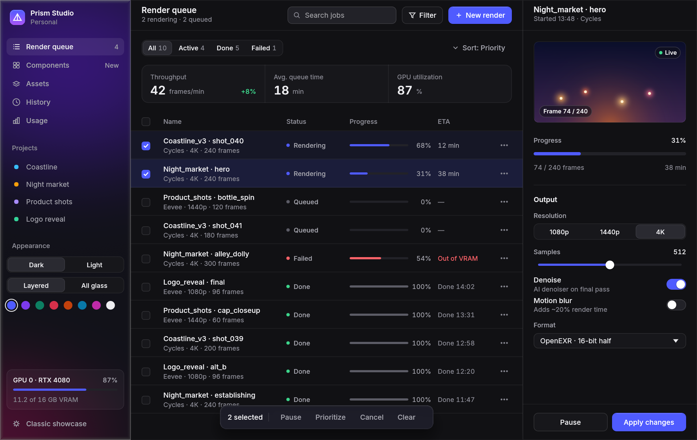
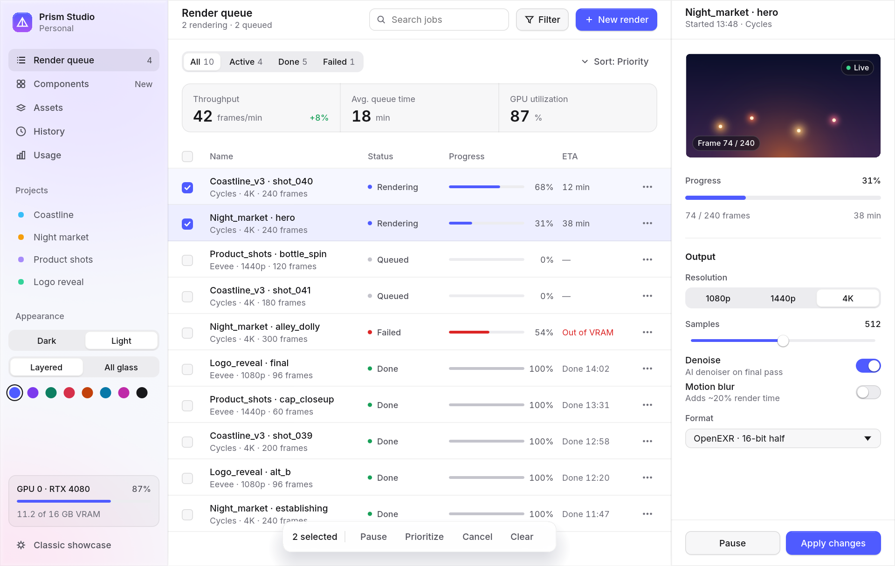
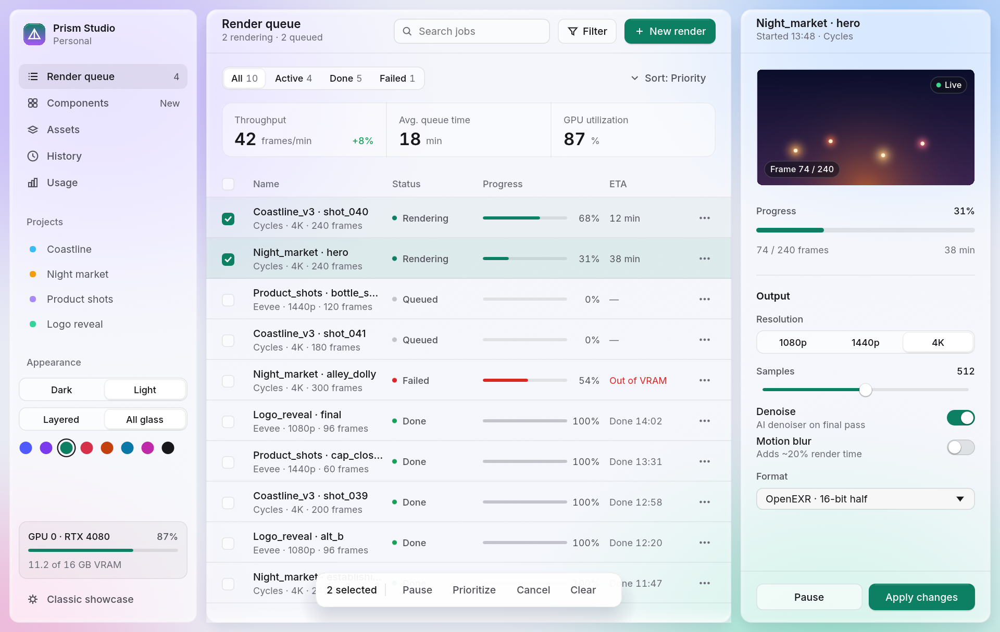
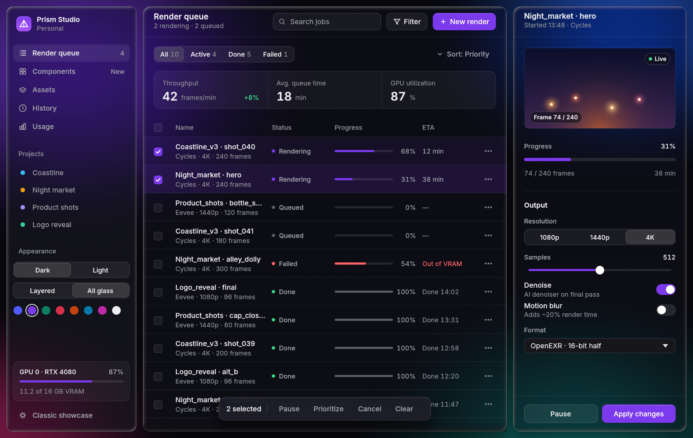
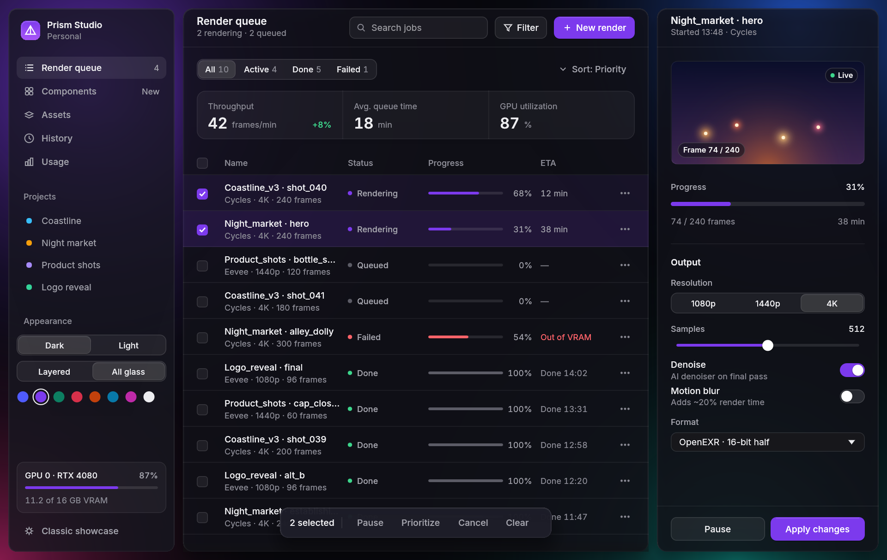
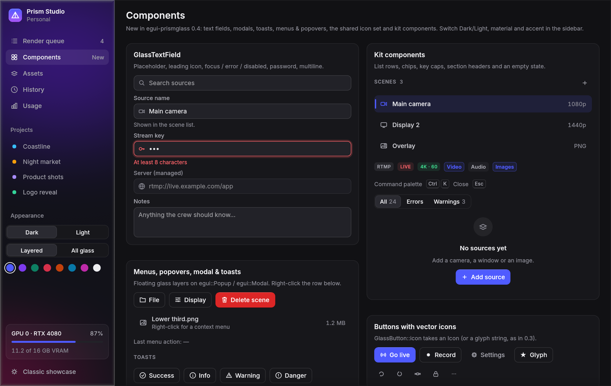
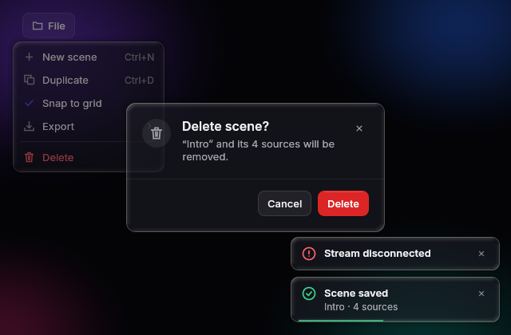
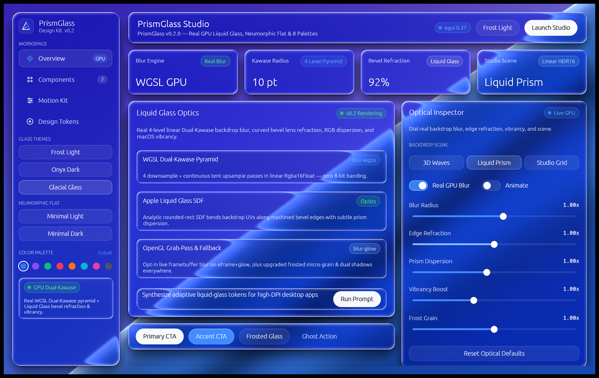
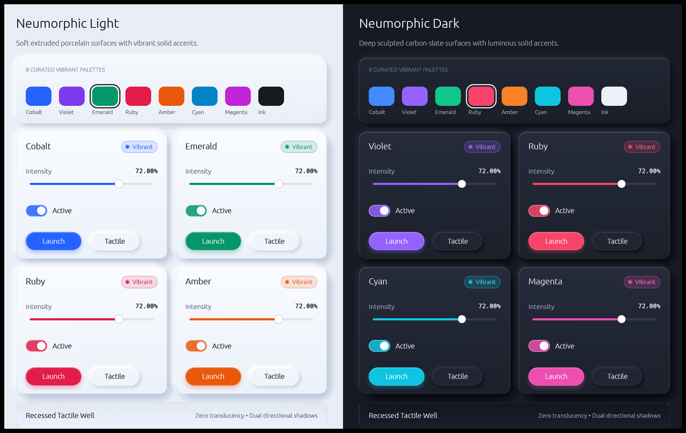

# egui-prismglass

<div align="center">

**A modern design system and widget kit for [`egui`](https://github.com/emilk/egui): calm, typographic interfaces with real GPU frosted glass where it counts.**

Inter typography, a 12-step neutral ramp, one accent, hairline borders and real GPU backdrop blur (WGSL Dual-Kawase on `wgpu`, live grab-pass on `glow`), with a pure-`egui` fallback that works on **every** backend.

[](https://github.com/kayoinreality/egui-prismglass/actions/workflows/ci.yml)
[](https://crates.io/crates/egui-prismglass)
[](https://docs.rs/egui-prismglass)
[](LICENSE)
[](https://crates.io/crates/egui/0.37.0)
[](https://kayoinreality.github.io/egui-prismglass/)



</div>

---

## Prism presets

Four presets share one design language: **two polarities × two materials**. The material decides where glass is used.

| **Prism Light** — Layered | **Prism Dark** — Layered |
| :---: | :---: |
|  |  |
| **Prism Glass Light** — All glass | **Prism Glass Dark** — All glass |
|  |  |

- **Layered** (`SurfaceStyle::Layered`): content is solid and flat; frosted glass is reserved for layers that float: sidebars, popovers, menus and floating toolbars. Glass stays special, and content stays easy to read.
- **All glass** (`SurfaceStyle::Frosted`): the same language with every container (panels, cards, sidebars) made of frosted glass over the backdrop. It is a more expressive option for kits, launchers and media apps.

Both materials use the new **Aurora** backdrop (soft violet, blue, teal and pink light pools), the bundled **Inter** typeface (Regular / Medium / Semibold plus tabular figures) and every `AccentPalette`. Each accent is calibrated so white labels on accent buttons keep at least 4.5:1 contrast.

```rust
use egui_prismglass::{PrismTheme, SurfaceStyle, AccentPalette};

let theme = PrismTheme::prism_dark();                     // Layered, dark
let theme = PrismTheme::prism_glass_light();              // All glass, light
let theme = PrismTheme::prism_dark()
    .with_material(SurfaceStyle::Frosted)                 // switch material, keep the rest
    .with_accent_palette(AccentPalette::Emerald);
```

Without a GPU blur provider, glass falls back to a denser frosted film, so it stays legible on every backend:



---

## Try the demo

**In your browser:** [kayoinreality.github.io/egui-prismglass](https://kayoinreality.github.io/egui-prismglass/) (WebAssembly, pure-`egui` glass fallback, any WebGL 2 browser).

```bash
# Prism Studio: real WGSL Dual-Kawase blur on eframe + wgpu
cargo run -p demo

# OpenGL live-framebuffer grab-pass blur on eframe + glow
cargo run -p demo --example glow_blur --no-default-features --features blur-glow
```

**Prism Studio** is a realistic render-queue app: a glass sidebar, filters, a stats strip, a sortable job table, an inspector and a floating action bar, with menus, a confirmation modal and toasts. The **Components** page shows every v0.4 widget (text fields, menus and popovers, modal, toasts, kit components and the icon set). Its **Appearance** controls switch between Dark/Light, Layered/All glass and every accent palette. The sidebar's **Classic showcase** entry opens the original v0.2 demo.



To build the web demo yourself:

```bash
rustup target add wasm32-unknown-unknown
cargo install --locked trunk
cd crates/demo && trunk serve   # or: trunk build --release
```

---

## Quick Start

### 1. Add `egui-prismglass` to `Cargo.toml`

```toml
[dependencies]
egui = "0.37.0"
# `blur-wgpu` enables real GPU frosted glass on eframe's default wgpu backend:
egui-prismglass = { version = "0.4.0", features = ["blur-wgpu"] }
# Or `features = ["blur-glow"]` for eframe+glow, or no features for the pure-egui fallback.
```

### 2. Install fonts and the blur provider once during setup (`eframe`)

```rust
// Inside eframe::run_native(..., Box::new(|cc| { ... })):
egui_prismglass::install_fonts(&cc.egui_ctx); // bundled Inter (feature `inter`, on by default)

#[cfg(feature = "blur-wgpu")]
if let Some(render_state) = cc.wgpu_render_state.as_ref() {
    egui_prismglass::blur_wgpu::install(&cc.egui_ctx, render_state);
}
```

*(For `eframe` + `glow`, call `egui_prismglass::blur_glow::install(&cc.egui_ctx, gl)` and call `provider.destroy(gl)` inside `eframe::App::on_exit`.)*

### 3. Build the UI

```rust
use egui_prismglass::{
    BadgeVariant, GlassBadge, GlassButton, GlassCard, GlassCheckbox, GlassElevation,
    GlassProgress, GlassSegmented, GlassSlider, GlassToggle, PrismContextExt, PrismTheme,
    paint_prism_backdrop_ui,
};

struct State { filter: usize, samples: f32, denoise: bool, motion_blur: bool }

fn render_ui(ui: &mut egui::Ui, state: &mut State) {
    let theme = PrismTheme::prism_dark();
    ui.ctx().set_prism_theme(theme.clone());

    // The Aurora backdrop: what glass surfaces frost (GPU-accelerated with `blur-wgpu`).
    paint_prism_backdrop_ui(ui, ui.max_rect(), &theme, 0.0, 1.0);

    GlassCard::new().elevation(GlassElevation::Elevated).show(ui, |ui| {
        ui.horizontal(|ui| {
            ui.heading("Render queue");
            ui.add(GlassBadge::new("Rendering").variant(BadgeVariant::Accent));
        });
        ui.add(GlassSegmented::new(&mut state.filter, &["All", "Active", "Done"]).counts(&[10, 4, 5]));
        ui.add(GlassProgress::new(0.31));
        ui.add(GlassSlider::new(&mut state.samples, 0.0..=1024.0).label("Samples").decimals(0));
        ui.add(GlassToggle::new(&mut state.denoise).label("Denoise"));
        ui.add(GlassCheckbox::new(&mut state.motion_blur).label("Motion blur"));
        ui.horizontal(|ui| {
            ui.add(GlassButton::secondary("Cancel"));
            ui.add(GlassButton::primary("Start render"));
        });
    });
}
```

| Widget | Purpose | Since |
| :--- | :--- | :---: |
| `GlassCard`, `GlassPanel`, `GlassSidebar` | Containers whose material follows the theme (solid or glass) | 0.1 |
| `paint_glass_surface_ui` | Paint a themed surface into any rect (docked regions, custom layouts) | 0.3 |
| `GlassButton` | `primary` / `secondary` / `ghost` / `danger` (+ `accent`, `tint`, `pill`, `icon(Icon)`, `icon_only`) | 0.1 |
| `GlassSegmented` | Tabs, filters and view modes, with `counts` or per-segment `optional_counts` | 0.3 |
| `GlassToggle`, `GlassCheckbox`, `GlassSlider` | Switch, checkbox and slider with Inter readouts | 0.1 |
| `GlassBadge` | Neutral status pill; color only in the status dot | 0.1 |
| `GlassProgress` | Thin progress bar for jobs, uploads and quotas | 0.3 |
| `SidebarItem` | Navigation row with built-in icons, or any `Icon` (`SidebarItem::with_icon`) | 0.1 |
| `GlassTextField` | Single-line / multiline input: placeholder, leading icon, label, help, focus / error / disabled states, password | **0.4** |
| `GlassModal` | Dialog over a scrim on `egui::Modal`: focus stays inside, `Esc` / scrim click close, title / body / footer actions | **0.4** |
| `GlassToasts`, `Toast` | Queued notifications: success / warning / danger / info, auto-dismiss with a progress bar, stacking, hover to pause | **0.4** |
| `GlassMenu`, `MenuItem`, `GlassPopover` | Dropdown and context menus (icons, shortcuts, separators, submenus) and popovers on `egui::Popup` | **0.4** |
| `Icon`, `GlassIcon` | 65 vector icons painted on a 16 pt grid (no icon font), shared by every widget | **0.4** |
| `GlassListRow`, `GlassChip`, `GlassKbd`, `GlassEmptyState`, `SectionHeader` | Kit components: selectable list row with marker, chip, key cap, empty state, tracked section header | **0.4** |

### Inputs, overlays and icons (v0.4)

```rust
use egui_prismglass::{
    GlassButton, GlassMenu, GlassModal, GlassTextField, GlassToasts, Icon, MenuItem, Toast,
};

struct App { query: String, confirm: bool, toasts: GlassToasts }

fn ui(app: &mut App, ui: &mut egui::Ui) {
    ui.add(GlassTextField::new(&mut app.query).placeholder("Search").icon(Icon::Search));

    let more = ui.add(GlassButton::icon_only(Icon::More));
    let _ = GlassMenu::new(&more).show(|ui| {
        ui.add(MenuItem::new("Duplicate").icon(Icon::Copy).shortcut("Ctrl+D"));
        GlassMenu::separator(ui);
        if ui.add(MenuItem::new("Delete").icon(Icon::Trash).danger(true)).clicked() {
            app.confirm = true;
        }
    });

    let mut deleted = false;
    let _ = GlassModal::new("delete")
        .title("Delete scene?")
        .icon(Icon::Trash)
        .show(ui.ctx(), &mut app.confirm, |ui| {
            GlassModal::footer(ui, |ui| {
                if ui.add(GlassButton::danger("Delete")).clicked() {
                    deleted = true;
                    ui.close();
                }
                if ui.add(GlassButton::secondary("Cancel")).clicked() {
                    ui.close();
                }
            });
        });
    if deleted {
        app.toasts.add(Toast::success("Scene deleted"));
    }
    app.toasts.show(ui.ctx()); // once per frame, after the rest of the UI
}
```



---

## Classic presets (v0.2)

The original 3D Liquid Glass and Neumorphic presets ship unchanged (`Frost`, `Onyx`, `Glacial`, `MinimalLight`, `MinimalDark`, see `PrismPreset::CLASSIC`). Their golden snapshots are byte-for-byte enforced in CI.

| **Apple Liquid Glass Optics (Snell Refraction & Tinted Pills)** | **Glacial Glass — Liquid Prism (Real GPU)** |
| :---: | :---: |
|  |  |

| **Frost Light (Real GPU Dual-Kawase)** | **Onyx Dark (Real GPU Dual-Kawase)** |
| :---: | :---: |
|  |  |

| **Minimal Light (Neumorphic Flat)** | **Minimal Dark (Neumorphic Flat + Violet)** |
| :---: | :---: |
|  |  |

<div align="center">

**Tactile Neumorphism (Light & Dark) + 8 Curated Vibrant Color Palettes Across Every Theme**



</div>

---

## Feature Flags

| Feature | Default | Description |
| :--- | :---: | :--- |
| `inter` | Yes | Bundles the Inter typeface (SIL OFL 1.1, ~0.9 MB) used by the Prism presets; install with `install_fonts(ctx)` |
| *(no blur feature)* | — | Zero-dependency fallback renderer with frosted film, micro-grain, shadows and hairlines |
| `blur-wgpu` | No | Pure-WGSL 4-level linear Dual-Kawase blur + Apple Liquid Glass optics on `wgpu 30` / `egui-wgpu 0.37.0` |
| `blur-glow` | No | Live-framebuffer OpenGL 3.3 / GLES 3.0 / WebGL 2.0 grab-pass blur on `glow 0.17` / `egui_glow 0.37.0` |
| `serde` | No | `Serialize` / `Deserialize` support for all tokens, scenes, and themes |

---

## `egui` Compatibility Table

`egui-prismglass` pins its `egui` version explicitly and documents every supported pairing below:

**Upgrading from 0.3 to 0.4** is source-compatible for typical code. The only signature change is `GlassButton::icon`, which now takes `impl Into<ButtonIcon>` instead of `impl Into<String>`: `&str` and `String` (and the new `Icon`) work as before, but other `Into<String>` types (e.g. `Cow<str>`, `Box<str>`) need `.to_string()` first. Everything else is additive. The library also builds for `wasm32-unknown-unknown` (checked in CI).

| `egui-prismglass` | `egui` / `eframe` | `wgpu` / `glow` | MSRV | Status |
| :---: | :---: | :---: | :---: | :---: |
| `0.4.x` | `0.37.0` | `wgpu 30.0` / `glow 0.17` | `1.95` | Supported (current) |
| `0.3.x` | `0.37.0` | `wgpu 30.0` / `glow 0.17` | `1.95` | Maintenance |
| `0.2.x` | `0.37.0` | `wgpu 30.0` / `glow 0.17` | `1.95` | Maintenance |
| `0.1.x` | `0.37.0` | — (fallback only) | `1.95` | Maintenance |

---

## Visual Regression Matrix & Reproducible Benchmarks

`egui-prismglass` ships with an **18-test automated GPU visual regression matrix** (executed in CI on every push) and **reproducible CPU + GPU benchmarks**. See [`docs/BENCHMARKS.md`](docs/BENCHMARKS.md) for the complete methodology, JSON export, and integrated GPU (Intel Iris Xe / AMD Radeon 780M / Apple Silicon UMA) bandwidth analysis.

### Automated Visual & Shader Test Matrix

| Domain | Verified Invariants (`visual_regression.rs`) |
| :--- | :--- |
| **Golden Snapshots & Determinism** | Bit-exact frame determinism + 11 golden PNG baselines (`Glacial`, `Onyx`, `Frost`, `Tinted Pills`, `Minimal Light`, `Minimal Dark`, `Prism Dark (Layered)`, `Prism Glass Light (All glass)`, and the v0.4 widgets: controls in Prism Dark / Light, overlays in Prism Glass Dark) with `PRISMGLASS_UPDATE_SNAPSHOTS=1` refresh workflow |
| **v0.4 Widgets** | Text fields in every state, kit components and icons, an open menu with a submenu row, a modal over its scrim (scrim dims the screen) and a stack of toasts with progress bars |
| **Prism Materials** | Layered content cards stay opaque and identical over any backdrop; All-glass cards pick up the backdrop beneath them |
| **Clipping & Rounding** | Zero pixel bleed outside `ui.set_clip_rect(...)` / `ScrollArea`; analytic SDF corner masking at `0 pt`, `24 pt`, and `999 pt` clamped pill |
| **DPI & Resolution Matrix** | `1.0x`, `1.5x`, `2.0x`, `2.5x` DPI scaling + dynamic runtime resize (`320×240 → 640×360 → 800×600 → 1280×720`) with exact 6-texture VRAM accounting |
| **Edge Artifacts** | 4 viewport-overhanging cards at max refraction & dispersion — zero UV wrap-around, zero NaNs, opaque alpha `255` everywhere |
| **Shader Optics & Cache Reuse** | Blur monotonicity (`0.5 → 10 → 32 pt`), convex-bezel Snell refraction, RGB chromatic dispersion `\|R − B\|`, Beer-Lambert tint transmission, GPU↔Fallback parity, and zero-reallocation pyramid + static backdrop cache hits |

### Performance & Memory Highlights

- **6-texture in-place `Rgba16Float` Dual-Kawase pyramid**: reuses `down3`, `down2`, and `down1_or_deep` during upsampling (**~17% less VRAM** than 9 separate targets) and runs **once per frame (`O(1)` in widget count)**.
- **Static Backdrop Cache (`BackdropCacheKey`)**: skips all 9 GPU blur passes (`0.00 ms` blur cost, `0.00 GB/s` blur bandwidth) whenever the backdrop is unchanged between frames.
- **CPU Surface Preparation (`cargo bench -p egui-prismglass --bench surface_bench`)**: `PrismTheme::surface` **124 ns** · `BackdropRequest` **62.6 ns** · `glass_surface_shapes` **12.4–13.3 µs** · 1,000 springs/frame **9.44 µs**.

| Resolution | Pyramid VRAM (6 × `Rgba16Float`) | Animated Blur Delta (`llvmpipe` CI baseline) | Static Cached Frame Reduction | Allocations |
| :--- | ---: | ---: | ---: | ---: |
| `1280×720` (720p) | **11.12 MiB** | 47.74 ms | **−52%** (`0` blur passes) | `1` |
| `1440×900` (900p) | **15.64 MiB** | 67.27 ms | **−56%** (`0` blur passes) | `1` |
| `1920×1080` (1080p) | **25.03 MiB** | 102.06 ms | **−56%** (`0` blur passes) | `1` |
| `2560×1440` (1440p) | **44.49 MiB** | 191.73 ms | **−59%** (`0` blur passes) | `1` |

*(Baseline measured in headless software Vulkan `llvmpipe` — 50×–200× slower than hardware GPUs, while preserving exact `O(W·H)` scaling and VRAM/cache counts. At `16–64` simultaneous cards, cached GPU Liquid Glass (`1.706 ms/surf`) also outperforms pure-`egui` fallback (`2.548 ms/surf`).)*

```bash
# Run the 18-test GPU visual regression & shader invariant matrix:
cargo test -p egui-prismglass --features blur-wgpu --test visual_regression

# Run reproducible CPU micro-benchmarks:
cargo bench -p egui-prismglass --bench surface_bench

# Run reproducible GPU resolution scaling (720p..1440p), 1..64 surface scaling & VRAM/cache audit on your GPU:
cargo run --release -p egui-prismglass --features blur-wgpu --example gpu_benchmark
```

---

## Roadmap

- [x] **v0.1.0**: Design tokens, 5 built-in presets across 3D Apple Glass & Minimal Solid, directional 3D bevel glass painter, spring & easing animation kit (`anim`), 7 core widgets, interactive `demo`, CI across Linux/Windows/macOS.
- [x] **v0.2.0**: Real GPU backdrop blur & Apple Liquid Glass rendering (`blur-wgpu` WGSL Dual-Kawase + SDF bevel refraction/dispersion/vibrancy, `blur-glow` live OpenGL grab-pass, optical material tokens, 3 procedural studio scenes, upgraded fallback micro-grain & dual shadows).
- [x] **v0.3.0**: Prism design language: four Prism presets (Layered & All glass, dark & light), bundled Inter typography, Aurora backdrop, `GlassSegmented`, `GlassProgress`, `GlassCheckbox`, a `danger` button and the Prism Studio demo.
- [x] **v0.4.0**: `GlassTextField`, `GlassModal`, `GlassToasts`, `GlassMenu` / `GlassPopover` on `egui::Popup`, the shared `Icon` set (ported from PrismCast Studio), kit components (`GlassListRow`, `GlassChip`, `GlassKbd`, `GlassEmptyState`, `SectionHeader`), `GlassSegmented::optional_counts`, and the live WebAssembly demo on GitHub Pages.
- [ ] **Next**: `GlassTabs`, `GlassSelect` / combo box, tooltips, a command palette, data table helpers, and GPU backdrop blur on the web (WebGPU).

---

## Contributing

Contributions are warmly welcomed! See [CONTRIBUTING.md](CONTRIBUTING.md) for local setup, design guidelines, and issues tagged [`good first issue`](https://github.com/kayoinreality/egui-prismglass/labels/good%20first%20issue).

## License

Licensed under the [MIT License](LICENSE).

The bundled [Inter](https://rsms.me/inter/) typeface (`crates/egui-prismglass/fonts/`, feature `inter`) is © The Inter Project Authors and licensed under the [SIL Open Font License 1.1](crates/egui-prismglass/fonts/OFL.txt). `InterTabularDigits.ttf` is a subset of Inter with its tabular figures (`tnum`) mapped as the default digits.