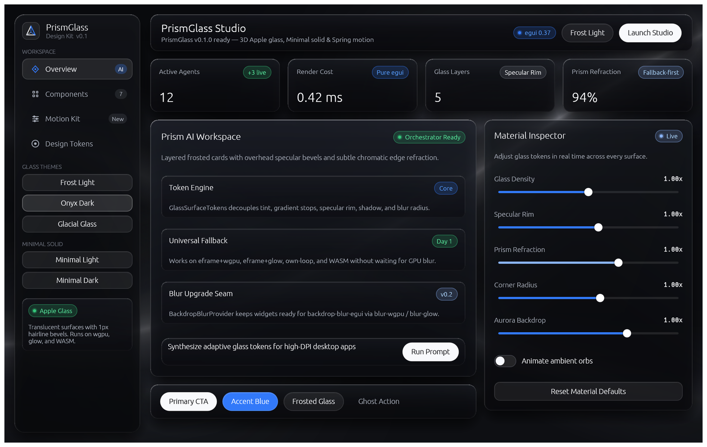

# egui-prismglass

<div align="center">

**A fallback-first glassmorphic design system and widget kit for [`egui`](https://github.com/emilk/egui).**

Translucent frosted gradients, luminous overhead specular rims, prismatic refraction highlights, elevation shadows, and cohesive design tokens—working out of the box on **every** `egui` backend with zero required GPU shaders.

[](https://github.com/kayoinreality/egui-prismglass/actions/workflows/ci.yml)
[](https://crates.io/crates/egui-prismglass)
[](https://docs.rs/egui-prismglass)
[](LICENSE)
[](https://crates.io/crates/egui/0.37.0)


</div>

---

## Visual Themes (Glass & Minimal Solid)

| **Frost Light (Apple Glass)** | **Onyx Dark (Apple Glass)** |
| :---: | :---: |
|  |  |

| **Minimal Light (Solid Flat)** | **Minimal Dark (Solid Flat)** |
| :---: | :---: |
|  |  |

---

## Why `egui-prismglass`?

Most desktop teams still reach for Electron because native immediate-mode UIs take too long to style cleanly. And in `egui`, real GPU backdrop blur today targets specific host loops (`own-loop` `egui-wgpu` or `eframe+glow`), leaving mainstream `eframe+wgpu` (the default in `eframe 0.37`) and many WebAssembly setups without glass surfaces.

**`egui-prismglass` bridges both gaps:**

1. **Works everywhere on Day 1** — Every glass surface is painted using pure `egui` meshes and painters: clean flat-translucent frosted panes, Apple-style 1px double-hairline glass edges, delicate overhead light catch, and subtle diffuse shadows.
2. **Two first-class design modes (`SurfaceStyle::Glass` & `SurfaceStyle::Minimal`)** — Switch the entire app between Apple-style glassmorphism (`Frost Light`, `Onyx Dark`, `Glacial Glass`) and ultra-clean solid flat UI (`Minimal Light`, `Minimal Dark`, also ideal for *Reduced Transparency* accessibility) with a single line of code.
3. **Zero GPU / shader lock-in** — Runs identically on `eframe+wgpu`, `eframe+glow`, own-loop `egui-wgpu`, WebAssembly, and headless `egui_kittest` snapshot tests.
4. **Real backdrop blur as an opt-in upgrade** — Design tokens already carry `blur_radius`, and every widget is architected around the backend-agnostic [`BackdropBlurProvider`](crates/egui-prismglass/src/blur.rs) seam so real GPU blur (`blur-wgpu` / `blur-glow` via `backdrop-blur-egui`) plugs in cleanly in `v0.2.0` without breaking widget APIs.

---

## Try the Demo in One Command

```bash
cargo run -p demo
```

The interactive **PrismGlass Studio** demo includes:
- Live switching across **Glass Themes** (`Frost Light`, `Onyx Dark`, `Glacial Glass`) and **Minimal Solid** (`Minimal Light`, `Minimal Dark`)
- **Material Inspector** with real-time sliders for Glass Density, Edge Light Catch, Refraction Tint, Corner Radius, and Ambient Luminance
- **Component Gallery** showcasing all 4 `GlassElevation` tiers and interactive widgets
- **Design Token Explorer** with live `PrismPalette` swatches and hex values

---

## Quick Start

Add `egui-prismglass` to your `Cargo.toml`:

```toml
[dependencies]
egui = "0.37.0"
egui-prismglass = "0.1.0"
```

Apply a theme and start composing surfaces:

```rust
use egui_prismglass::{
    BadgeVariant, GlassBadge, GlassButton, GlassCard, GlassElevation,
    PrismContextExt, PrismTheme, paint_prism_backdrop,
};

fn render_ui(ui: &mut egui::Ui) {
    // 1. Pick Glass (frost / onyx / glacial) or Minimal Solid (minimal_light / minimal_dark):
    let theme = PrismTheme::frost(); // or PrismTheme::minimal_light()
    ui.ctx().set_prism_theme(theme.clone());

    // 2. Paint the theme backdrop (atmospheric in Glass mode, clean flat canvas in Minimal mode):
    let rect = ui.max_rect();
    paint_prism_backdrop(ui.painter(), rect, &theme, 0.0, 1.0);

    // 3. Compose widgets with zero boilerplate:
    GlassCard::new()
        .elevation(GlassElevation::Elevated)
        .show(ui, |ui| {
            ui.horizontal(|ui| {
                ui.heading("PrismGlass Card");
                ui.add(GlassBadge::new("Ready").variant(BadgeVariant::Success).dot(true));
            });

            ui.label("Clean translucent glass or crisp solid minimal UI on any backend.");
            ui.add_space(8.0);

            ui.horizontal(|ui| {
                if ui.add(GlassButton::primary("Launch").pill(true)).clicked() {
                    // handle primary action
                }
                let _ = ui.add(GlassButton::accent("Accent Blue").pill(true));
                let _ = ui.add(GlassButton::secondary("Frosted Glass").pill(true));
            });
        });
}
```

---

## What's Included

| Module / Crate | Responsibility |
| :--- | :--- |
| `egui-prismglass::tokens` | `GlassSurfaceTokens`, `GlassElevation` (`Flat`, `Subtle`, `Elevated`, `Floating`), `PrismPalette`, `SpacingTokens`, `RadiusTokens` |
| `egui-prismglass::theme` | `PrismTheme`, `ThemeMode`, `SurfaceStyle` (`Glass` / `Minimal`), `PrismPreset` (`Frost`, `Onyx`, `Glacial`, `MinimalLight`, `MinimalDark`), global `egui::Visuals` harmonization |
| `egui-prismglass::painter` | Pure-`egui` 3D directional-bevel glass & solid minimal renderer (`paint_glass_surface`, `glass_surface_shapes`) & sculpted volumetric light-wave backdrop (`paint_prism_backdrop`) |
| `egui-prismglass::anim` | Spring physics (`SpringConfig`, `SpringState`), `Easing` curves, `PrismAnimExt`, hover micro-lift, pulse, and shimmer helpers |
| `egui-prismglass::widgets` | `GlassCard`, `GlassPanel`, `GlassButton`, `GlassSidebar` + `SidebarItem`, `GlassSlider`, `GlassBadge`, `GlassToggle` |
| `egui-prismglass::blur` | Backend-agnostic `BackdropRequest`, `BlurCapability`, and `BackdropBlurProvider` seam for future real GPU blur |
| `crates/demo` | Interactive **PrismGlass Studio** showcase app (`cargo run -p demo`) with Motion Kit playground |

### Optional Features

- `serde`: Enables `serde::Serialize` and `serde::Deserialize` on all design tokens and themes.

---

## `egui` Compatibility Table

`egui` introduces breaking API changes regularly. `egui-prismglass` pins its `egui` version explicitly and documents every supported pairing below:

| `egui-prismglass` | `egui` / `eframe` | MSRV | Status |
| :---: | :---: | :---: | :---: |
| `0.1.x` | `0.37.0` | `1.95` | Supported (current) |

---

## Roadmap

- [x] **v0.1.0 (MVP)**: Design tokens, 5 built-in themes across 3D Apple Glass (`Frost Light`, `Onyx Dark`, `Glacial Glass`) and Minimal Solid (`Minimal Light`, `Minimal Dark`), directional 3D bevel glass painter, spring & easing animation kit (`anim`), 7 core widgets, interactive `demo`, CI across Linux/Windows/macOS.
- [ ] **v0.2.0**: Opt-in real GPU backdrop blur features (`blur-glow` and `blur-wgpu`) integrating `backdrop-blur-egui` through `BackdropBlurProvider`.
- [ ] **v0.3.0**: Extended widget set (`GlassTextField`, `GlassModal`, `GlassTabs`, `GlassToast`, `GlassProgressBar`) + WASM live web demo.

---

## Contributing

Contributions are warmly welcomed! See [CONTRIBUTING.md](CONTRIBUTING.md) for local setup, design guidelines, and issues tagged [`good first issue`](https://github.com/kayoinreality/egui-prismglass/labels/good%20first%20issue).

## License

Licensed under the [MIT License](LICENSE).